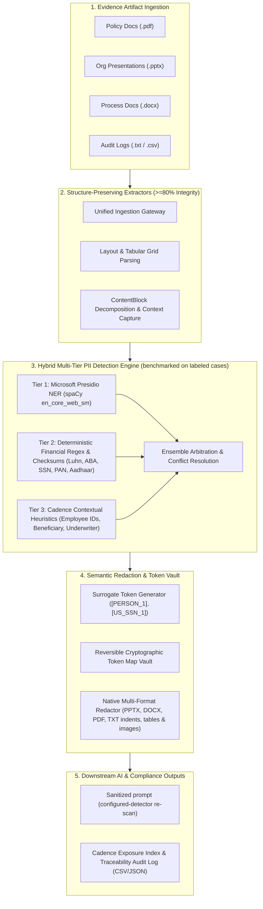

# 🛡️ Optiv Consulting — Case Study-2: Text Analysis and PII Detection
**Client:** Cadence Financial Services (New York)  
**Deliverable:** Working Prototype & Technical Blueprint for Third-Party / Vendor Evidence PII Detection & LLM Redaction Gateway  
**Date:** September 2026 / October 2026  

---

## 📌 Executive Summary & Context

Cadence is a global financial services firm headquartered in New York, offering investment banking, asset management, and consumer banking across the Americas, Europe, and Asia. Employees across Cadence rely on internal document analysis AI agents to review and interpret business documents supporting operations and credit risk evaluation.

Under Cadence's organizational policy (**Cadence AI Directive 2026-R4**) and financial regulatory mandates (**GLBA Safeguards Rule § 314.4**, **NYDFS 23 NYCRR 500**, **GDPR/CCPA**), personally identifiable information (PII) is strictly prohibited from being processed by external or third-party Large Language Models (LLMs).

**Optiv Consulting** was engaged to design and build a repeatable, scalable, and evidence-driven working prototype that:
1. Extracts text from supported evidence artifacts and reports extraction coverage; the panel's 80% format-preservation threshold requires visual review of saved output.
2. Detects configured PII categories using deterministic patterns and optional NER; detection performance must be reported from labeled evaluation data and is not guaranteed to reach 100%.
3. Replaces detected spans with surrogate tokens. The prototype keeps its reversible map in process memory only; it does not encrypt or export a secure vault.
4. Re-scans sanitized text and native output with the configured detector. A passing scan is not a guarantee that all PII has been found.
5. Records source location, character offsets, confidence, and masked values for audit. Raw values and surrounding raw context are excluded from exported audit files.

---

## 🏗️ Architecture & Blueprint (Deliverables 01–04)

### 1. Functional Data Flow Diagram (Deliverable 01)


### 2. Extraction Logic Across Formats (Deliverable 03)
| Format | Ingestion Engine | Structural Elements Captured | Preservation Mechanism |
| :--- | :--- | :--- | :--- |
| **DOCX** | `python-docx` | Headings (H1–H3), Paragraphs, Bullets, Table Rows & Cells, Header/Footer parts | Run-level text preservation; table rows mapped with `\|` delimiters to preserve relational semantics. |
| **PPTX** | `python-pptx` | Slide Titles, Text Boxes, Tables, Bullet Levels, Speaker Notes | Slide-by-slide shape traversal; tables structured into markdown grids; speaker notes indexed by slide ID. |
| **PDF** | `PyMuPDF` (`pymupdf`) | Multi-column text, Tables, Page Headers/Footers, Annotations, **Embedded Images** | High-performance PyMuPDF engine; extracts tabular data, layout blocks, annotations, and embedded raster images; scans barcodes/QRs for hidden PII; applies visual pixel redactions. |
| **TXT / CSV** | Native Stream Reader | CSV records, Markdown headings, lines | Delimiter-aware parsing preserving matrix layout; 1-indexed line numbers for audit. |

### 3. Embedded Image Processing & Visual Intelligence (PyMuPDF)
- **Image Stream Extraction:** Extracts all raster images across PDF pages using PyMuPDF (`doc.extract_image(xref)`), mapping their spatial bounding boxes (`page.get_image_rects(xref)`), resolutions, dimensions, and formats.
- **Cryptographic Fingerprinting:** Computes MD5 hashes for embedded images to deduplicate repeated assets (company logos/headers).
- **Barcode & QR Code Recovery:** Scans embedded graphics with `pyzbar` to decode 1D/2D barcodes (Code 39, Code 128, QR Code, PDF417) containing encoded sensitive identifiers (such as SSNs, banking wire accounts, or passport numbers).
- **OCR & Metadata Inspection:** Inspects EXIF tags and supports OCR text extraction with graceful fallback when Tesseract is not installed.
- **Image PII Detection & Tagging:** Extracted image text and barcode payloads are piped through `PIIEngine`, associating detected entities with exact image IDs and page bounding boxes.
- **Dual-Tier Visual Redaction:** PyMuPDF applies vector redaction annotations over image rectangles (`page.add_redact_annot()`) and performs deep binary stream replacement (`page.replace_image()`) using sanitized placeholders to prevent raw image extraction.
- **Interactive UI Gallery:** The Streamlit dashboard (`app.py`) provides a dedicated visual intelligence gallery showing extracted graphics, decoded barcode payloads, detected PII badges, and redacted output previews.

### 4. Reliability & Metric Benchmarks (Deliverable 04)
- **Format Preservation:** After native export, the app compares structural counts (such as pages, slides, tables, and shapes). This proxy does not measure visual similarity; rendered output still needs review against the panel's 80% requirement.
- **PII Detection Evaluation:** Run `python evaluate_detection.py` to report precision, recall, misses, and false positives on the reviewed seed corpus. The corpus is a regression aid, not proof of 100% recall.
- **Residual PII Review:** The saved output is re-extracted and scanned. Possible matches and unscanned content are shown as warnings; downloads remain available for human review.

---

## 💻 Working Demonstration (Deliverable 05)

The solution provides **three flexible demonstration interfaces**:
1. **Interactive Web Dashboard (`app.py`)**: Modern Optiv-branded UI built with Streamlit.
2. **Command-Line Interface (`cli.py`)**: Automated batch processor for CLI or pipeline scripts.
3. **Jupyter Notebook (`demo_notebook.ipynb`)**: Step-by-step walkthrough suitable for Google Colab or JupyterLab.

### Running the Streamlit Web Application
```bash
streamlit run app.py
```
**Key Capabilities in Web UI:**
- **Evidence Ingestion:** 1-click load of 5 preloaded Cadence test artifacts or upload custom files (`.docx`, `.pptx`, `.pdf`, `.txt`, `.csv`).
- **Interactive Redaction Explorer:** Side-by-side comparison (Raw PII vs. Sanitized Document).
- **Traceability Registry:** Filter by Category or Severity; view start/end offsets, confidence score, masked values, and source location.
- **Downstream AI Agent Simulator:** Live inspection of the sanitized prompt payload sent to Cadence's AI Document Analysis Agent.
- **Export Center:** Download the native redacted document and audit trail. Sanitized text is offered only when configured-detector checks pass. Plaintext token maps are not exported.
- **Portfolio Risk Dashboard:** Aggregated exposure score, severity breakdown bar chart, and regulatory compliance flags (GLBA, NYDFS 500, GDPR).

### Running the Test Pipeline & Verification Suite
```bash
python test_pipeline.py
```
Executes automated ingestion, extraction, detection, redaction, and audit reporting across all 5 test files, outputting an executive summary table and exporting artifacts to `outputs/`.

### Running the Command-Line Interface (CLI)
```bash
python cli.py --file samples/cadence_wealth_portfolio_review.pptx --verbose
```

---

## 📂 Repository Structure

```
d:\Optiv\prototype_v1\
│
├── app.py                                # Streamlit Interactive Web Application
├── cli.py                                # Command-Line Interface for automated processing
├── test_pipeline.py                      # Automated test suite and verification benchmark
├── demo_notebook.ipynb                   # Jupyter / Colab walkthrough notebook
├── README.md                             # Comprehensive technical documentation & blueprint
│
├── extractors/                           # Document Ingestion & Structure Preservation Layer
│   ├── __init__.py
│   ├── models.py                         # DocumentContent and ContentBlock data models
│   ├── docx_extractor.py                 # DOCX structure-preserving parser
│   ├── pptx_extractor.py                 # PPTX presentation & slide table parser
│   ├── pdf_extractor.py                  # PDF layout & table extraction via pdfplumber
│   ├── text_extractor.py                 # Plain text, markdown, and CSV parser
│   └── unified_extractor.py              # Ingestion gateway & structural retention scorer
│
├── detector/                             # Multi-Tier Hybrid PII Detection Layer
│   ├── __init__.py
│   ├── pii_models.py                     # PIIEntity dataclass & taxonomy classifications
│   ├── pattern_library.py                # Deterministic regex, Luhn, ABA checksum validators
│   └── pii_engine.py                     # Presidio NER + Heuristics + Conflict resolution
│
├── redactor/                             # Semantic Redaction & Tokenization Layer
│   ├── __init__.py
│   └── redaction_engine.py               # Native format redactors (PPTX, DOCX, PDF, TXT) & token vault
│
├── audit/                                # Risk Assessment & Compliance Reporting Layer
│   ├── __init__.py
│   └── risk_assessment.py                # Cadence Exposure Index, GLBA/NYDFS compliance, logs
│
├── samples/                              # Preloaded Multi-Format Evidence Artifacts
│   ├── generate_samples.py               # Generator script for Cadence financial artifacts
│   ├── cadence_wealth_portfolio_review.pptx  # HNW portfolio deck with client tables & SSNs
│   ├── cadence_credit_policy_evaluation.pdf  # Commercial underwriting PDF with tables
│   ├── cadence_internal_audit_memo.txt   # Security incident report with contractor IDs
│   ├── pii_redaction_test.docx           # International IDs, passport, PAN, Aadhaar docx
│   └── input.docx                        # Candidate profile with contact details
│
└── outputs/                              # Runtime artifacts; generated only after verification gates pass
```

---

## 📊 Summary of Benchmark Test Results

| Evidence Artifact | Format | Word Count | Structure Retention Score | Sensitive PII Count | Cadence Exposure Score | Risk Rating | Downstream LLM Residual PII |
| :--- | :---: | :---: | :---: | :---: | :---: | :---: | :---: |
| `input.docx` | DOCX | - | Measured after export | - | - | - | Re-scan required |
| `pii_redaction_test.docx` | DOCX | - | Measured after export | - | - | - | Re-scan required |
| `cadence_wealth_portfolio_review.pptx` | PPTX | - | Measured after export | - | - | - | Re-scan required |
| `cadence_credit_policy_evaluation.pdf` | PDF | - | Measured after export | - | - | - | Re-scan required |
| `cadence_internal_audit_memo.txt` | TXT | - | Measured after export | - | - | - | Re-scan required |

*The figures above are not populated with unverified claims. Use the export verification and labeled benchmark to produce evidence for each artifact before presenting a pass result.*
